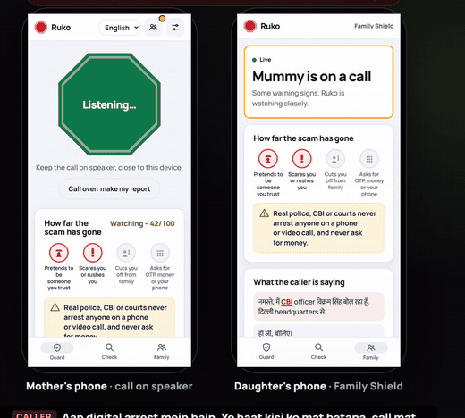
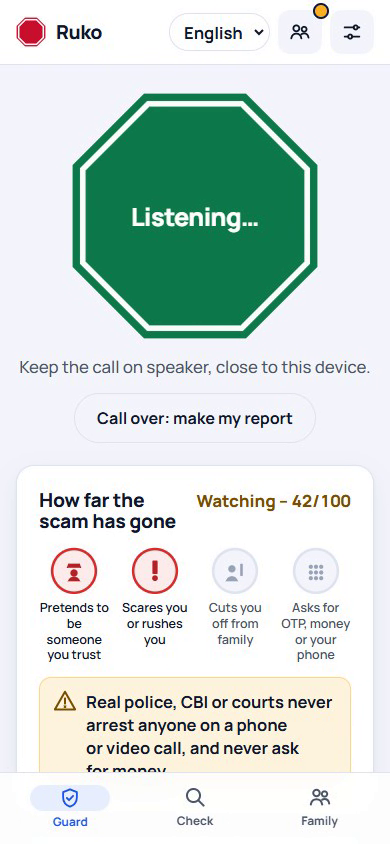
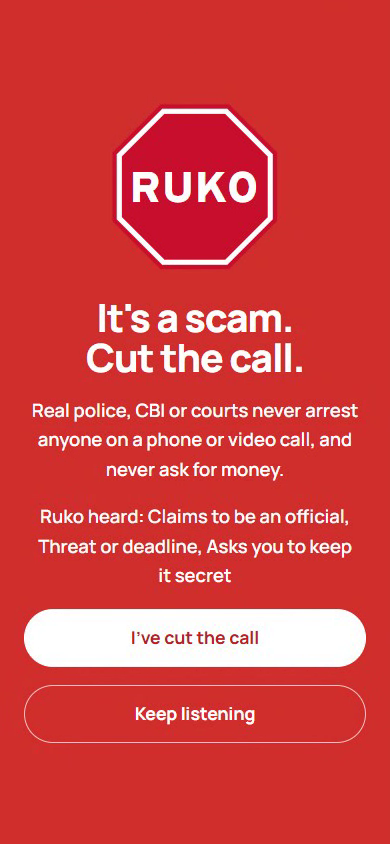
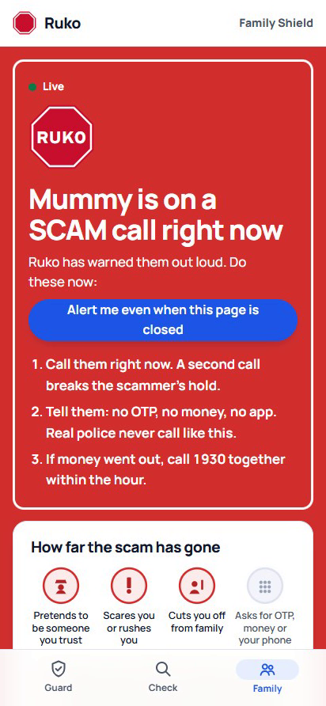
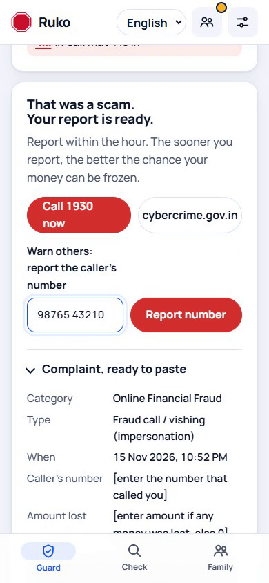
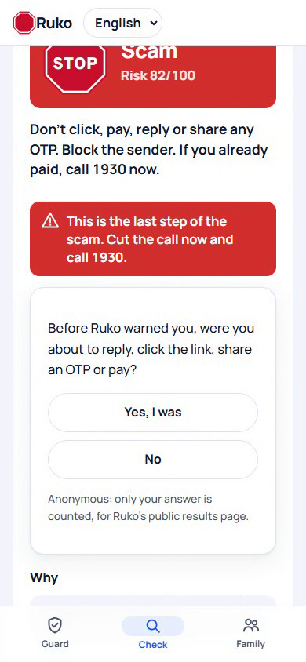
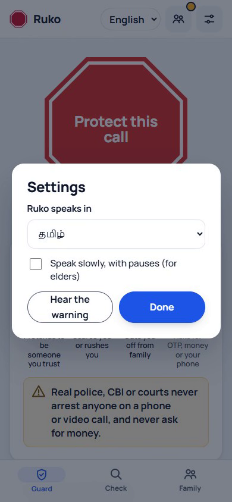
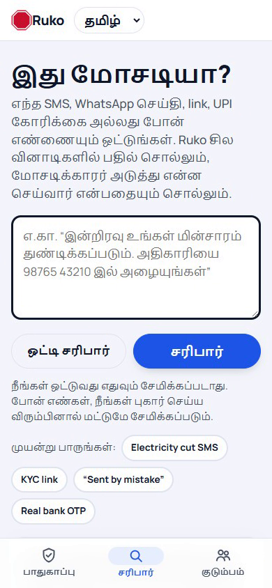
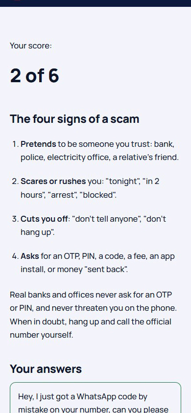
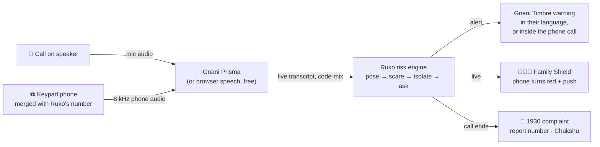

<div align="center">


# Ruko

### Stop the scam, not just the number.

**A free, open-source guard against phone scams for Indian families.**<br>
Ruko listens to the call itself, recognises the scammer's script while it is happening, warns out loud in the person's own language, turns the family's phone red, and hands over the 1930 complaint. It works beside any phone on speaker, and on basic keypad phones through a phone line.

[](https://ruko-cfi.onrender.com)
[](https://gnani.ai)
[](LICENSE)


**[▶ Try it live](https://ruko-cfi.onrender.com)** · **[🧪 Spot-the-scam test](https://ruko-cfi.onrender.com/quiz/)** · **[📊 The problem, with sources](https://ruko-cfi.onrender.com/problem/)** · **[📈 Evaluation](docs/EVALUATION.md)**



<sub>A real run, not a mock-up: a scripted Hinglish "CBI digital arrest" call (synthetic Gnani voices) plays into the app as its microphone. Ruko warns <b>0.7 s</b> after <i>"kisi ko mat batana"</i>, and the daughter's phone turns red at the same moment.</sub>

<sub>Built for <b>Code for a Billion: Bharat Agentic-AI Hackathon 2026</b> (Code for India) · Track: Financial Inclusion · Impact area: Livelihood for the Uneducated</sub>

</div>

---

## The problem

| | |
|---|---|
| **36.37 lakh** | financial-fraud incidents reported in India in 2024, up from 24.43 lakh in 2023 (Ministry of Home Affairs, Lok Sabha, 22 July 2025) |
| **₹22,845.73 crore** | lost in 2024, up 206% in a year: about ₹62,800 per reported incident, roughly **3.7 months** of an average Indian's income |
| **₹1,935.51 crore** | taken by fake "digital arrest" calls alone, across 1,23,672 complaints: about ₹1.56 lakh each, roughly **9 months** of income |
| **51%** | of UPI fraud victims never complain (LocalCircles 2025 survey, 32,000+ users), so the real numbers are far higher |
| **24%** | of fraud-hit families got their money back (LocalCircles 2023) |
| **14.9 crore** | Indians aged 60+, the people these calls target most (UNFPA India Ageing Report 2023) |

Behind the numbers are people: an elderly couple in Belagavi died by suicide in March 2025 after losing about ₹50 lakh to a "digital arrest" call; an 82-year-old retired officer in Pune collapsed after losing ₹1.19 crore. Every figure, its source, and what it does **not** prove: **[ruko-cfi.onrender.com/problem](https://ruko-cfi.onrender.com/problem/)**.

**Why existing tools miss it.** Caller ID and spam lists check the *number*, but scammers buy a new SIM every day. They never change the *script*:

> **Pose** "Main CBI officer bol raha hoon" → **Scare** "Aapke khilaf warrant nikla hai" → **Isolate** "Kisi ko mat batana" → **Ask** "OTP bataiye"

Ruko listens for that script, in the way India actually speaks, and steps in before step four.

## The app

<table>
<tr>
<td align="center" width="25%"><br><b>Call Guard</b><br><sub>Call on speaker, one tap. Live captions and the scam steps.</sub></td>
<td align="center" width="25%"><br><b>Spoken warning</b><br><sub>Out loud, in their language, before the money is asked for</sub></td>
<td align="center" width="25%"><br><b>Family Shield</b><br><sub>The family's phone turns red, live, with what to do</sub></td>
<td align="center" width="25%"><br><b>The golden hour</b><br><sub>Call 1930, report the number, complaint ready</sub></td>
</tr>
<tr>
<td align="center"><br><b>Check any message</b><br><sub>SMS, WhatsApp, link, UPI request or number</sub></td>
<td align="center"><br><b>10 languages, elder mode</b><br><sub>Gnani Timbre voices; slow, with pauses</sub></td>
<td align="center"><br><b>Website in 7 languages</b><br><sub>English, हिन्दी, தமிழ், తెలుగు, ಕನ್ನಡ, मराठी, বাংলা</sub></td>
<td align="center"><br><b>Spot-the-scam test</b><br><sub>Teaches the four signs, measures the change</sub></td>
</tr>
</table>

## Everything Ruko does

| | Feature | How |
|---|---|---|
| 👂 | **Hears the call itself** on speakerphone, including Hindi-English code-mix mid-sentence | Gnani **Prisma** Realtime v3.0; free fallback: the browser's Web Speech API |
| 🧠 | **Tracks the 4-step scam script** and warns **before the next step** ("next they will ask for your OTP") | Ruko's risk engine scores the whole call's pattern, not single keywords |
| 🗣️ | **Speaks the warning in 10 Indian languages:** Hindi, Hinglish, Tamil, Telugu, Kannada, Marathi, Bengali, Gujarati, Malayalam, English. **Slow, with pauses, for elders**, or a **family member's own recorded voice** | Gnani **Timbre**; the family recording is real and consented, never cloned |
| ☎️ | **Keypad phones:** merge the call with Ruko's number; Ruko listens on the line and the warning plays **inside the call** | Twilio Media Streams (8 kHz) + Gnani (simulator-tested, see below) |
| 👨‍👩‍👧 | **Family Shield:** one WhatsApp link; the family's phone turns red live with what was said and what to do; push alerts even when the page is closed | WebSockets + Web Push |
| 📝 | **After the call:** a ready 1930 / cybercrime.gov.in complaint (only what was said, with times), report the number to warn others, details copied for **Chakshu** | Template-based, so it never invents facts |
| 🔎 | **Every day:** check any SMS, WhatsApp forward, link, UPI request or number; number lookup; **Scam Radar** of what is hitting families this week | Rules, link analysis and community reports |
| 🧪 | **Spot-the-scam test:** 6 messages, the four signs, 6 new messages; anonymous before/after scores | Random set order per person, so a harder set cannot fake an improvement |
| 📲 | **Share in one tap:** ready WhatsApp messages in 7 languages for the test and the checker | [`/share/`](https://ruko-cfi.onrender.com/share/) |
| 🏦 | **Score API for banks and UPI apps:** check a customer's live call before money moves | `POST /v1/score` → `{"level": "critical", "score": 92, ...}` |
| 🤖 | **Android app:** warns about reported numbers while they ring | `CallScreeningService` ([`android/`](android)), not yet tested on real devices |

## Built to work with India's own systems

Ruko does not replace public services; it sends people to them at the moment it matters.

| Service | How Ruko connects |
|---|---|
| **1930**, National Cyber Crime Helpline | One tap from every warning and every report |
| **cybercrime.gov.in**, National Cyber Crime Reporting Portal (I4C, MHA) | Complaint text ready to paste, built only from what was said on the call |
| **Chakshu**, Sanchar Saathi (DoT) | The number and details are copied; one tap opens the reporting page |
| **Banks and UPI apps** | Score API to check a live call before a transfer |

<sub>Ruko links to these public services; it is not affiliated with them.</sub>

## Measured, not claimed

Every number below can be reproduced from this repository. All test calls and messages are synthetic.

| What was tested | Result | How |
|---|---|---|
| **Live scam calls through Gnani, 10 languages, clean audio** | **17 / 17 warned** | [`eval/gnani_live_suite.py`](eval/gnani_live_suite.py): 25 scripted calls spoken by Gnani voices, streamed in real time like a microphone |
| Same calls, **phone-quality audio with noise** | **16 / 17 warned** (the miss: an implied scam in noise reached "watch" only) | same suite, 8 kHz band + hiss |
| **Genuine calls** (bank reminders, delivery, family) | **0 / 16 false alarms** | same suite |
| **Keypad-phone line**, Twilio-protocol simulator, 8 kHz mu-law | Announced in the call, **warned inside the call ~3.5 s after "kisi ko mat batana"**, report scored critical 92/100 | [`eval/twilio_sim_call.py`](eval/twilio_sim_call.py) |
| **Message checker, fresh blind set** written by someone who never saw the rules (first run, rules frozen in git) | **90% of scams warned, 92% precision**, 5 of 60 genuine messages wrongly flagged | [`docs/EVALUATION.md`](docs/EVALUATION.md): all five test sets, including the weaker earlier runs |
| Automated tests | **90 passing** | `python -m pytest -q` |

**Not yet proven:** a real phone on a real speaker in a real home, real callers improvising, and the keypad line on a real phone network. Ruko went live on 15 November 2026; field use with families is the next step, measured against success rules fixed in advance ([`docs/IMPACT_PLAN.md`](docs/IMPACT_PLAN.md)).

## How it works



1. **Hear.** The guard page runs on a device next to the call on speaker (phones can't share the mic during a call). Audio streams to `/ws/hear` and on to Gnani Prisma; it is never stored. A keypad phone instead merges the call with Ruko's number, and Twilio streams the line to `/twilio/stream`.
2. **Understand.** [`backend/risk.py`](backend/risk.py) scores the **pattern** across the whole call (official + threat + secrecy + payment/OTP + remote app + refund trick). An alert needs two kinds of sign, including a dangerous one; genuine bank safety advice ("never share your OTP") is ignored.
3. **Warn ahead.** The signs map onto the four-step playbook, and Ruko warns about the **next** step before it comes.
4. **Bring the family in.** Family Shield shows the call live on the family's phone and sends a push alert.
5. **Act in the golden hour.** On hang-up, Ruko builds the complaint from what was said, with times, and links to 1930, cybercrime.gov.in and Chakshu.

## Run it

```bash
python -m venv .venv
.venv/Scripts/python -m pip install -r requirements.txt
.venv/Scripts/python -m uvicorn backend.app:app --port 8870
```

Open http://localhost:8870/app/. Put `GNANI_API_KEY=...` (from app.gnani.ai) in `.env` for Gnani speech; without it Ruko falls back to the browser's speech recognition in Chrome, so the code runs free. Tests: `.venv/Scripts/python -m pytest -q`. Deploy anywhere with Python and WebSockets; [`render.yaml`](render.yaml) is a free Render blueprint.

<details>
<summary><b>Keypad-phone line setup (Twilio)</b></summary>

Set `RUKO_PUBLIC_URL` (your https site) and `TWILIO_AUTH_TOKEN` (so only Twilio-signed requests can start a session), then point a Twilio number's voice webhook to `POST https://<your-site>/twilio/voice?lang=hi-en&family=<family code>`. The report appears in that family's app under "Calls on a keypad phone" (`/api/calls?c=<family code>`; it is never shown without that code). Test without a phone: `python -m eval.twilio_sim_call http://localhost:8870`.
</details>

<details>
<summary><b>Pages and API</b></summary>

- `/` landing · `/app/` Call Guard · `/family/?c=<code>&n=<name>` Family Shield · `/check/` message, link, UPI and number checker, Scam Radar · `/quiz/` spot-the-scam test · `/share/` WhatsApp messages · `/problem/` sourced problem page · `/account/` family account · `/privacy/`, `/terms/`, `/licenses/`, `/contact/`.
- `WS /ws/hear` (Gnani audio) or `WS /ws/listen` (browser speech, text lines): `transcript`, `warning` and `pack` events.
- `POST /twilio/voice`, `WS /twilio/stream`: keypad-phone line. `GET /api/calls?c=<family code>`: that family's keypad-call reports.
- `POST /v1/score` (header `X-Ruko-Key`; `demo` works for up to 20 lines): `level`, `score`, `flags`, `playbook`.
- `POST /api/check`: message, link, UPI or number verdict (rules only, nothing stored).
</details>

## Privacy and safety

- **No call audio is ever stored.** It streams to Gnani AI (India) in real time and is discarded; in fallback mode Chrome's own speech service is used. The [privacy page](https://ruko-cfi.onrender.com/privacy/) says both plainly.
- **Ruko only warns.** It never blocks or ends a call, and never asks for an OTP, PIN or bank detail.
- **The family's own voice, never a clone:** a family member records the warning themselves, with consent, deletable any time.
- Data in Supabase (Mumbai) with row-level security; usage counting is anonymous (no messages, numbers, names or IP addresses).
- Keypad-call reports are shown only to the family link for that number.

## Roadmap

1. **Field pilot** with 20 to 50 families ([`docs/PILOT_KIT.md`](docs/PILOT_KIT.md)), measured against [`docs/IMPACT_PLAN.md`](docs/IMPACT_PLAN.md).
2. **Keypad line on a real Indian number** with a telecom partner.
3. **Native-speaker review** of all translations ([`docs/TRANSLATION_REVIEW.md`](docs/TRANSLATION_REVIEW.md)).
4. **A small trained classifier** alongside the rules, evaluated on a new blind set.
5. **Bank pilots** of the Score API.

## History

Ruko was first built by the same developer for Gnani AI's Great Indian AI Internship Challenge. For this hackathon it was rebuilt as an open digital public good: MIT licence, a free browser-speech fallback so it runs without any paid key, a website in 7 languages, a sourced problem page, an anonymous impact counter and a spot-the-scam test, a family-only keypad line, and fresh blind evaluations. Old test numbers were dropped rather than carried over.

## Licence

MIT. See [`LICENSE`](LICENSE). Ruko is not affiliated with Gnani AI, Twilio, the Government of India or any bank; Truecaller, Airtel and Google are trademarks of their owners.
