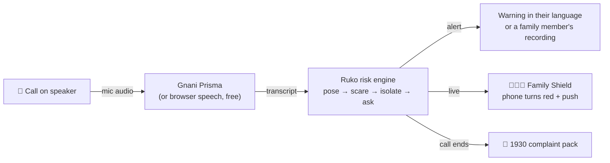

<div align="center">


# Ruko

### Stop the scam, not just the number.

**A free, open-source scam-call guard for Indian families.** Ruko hears the call itself, spots the scammer's script mid-sentence, warns out loud in 10 Indian languages (even in a family member's own recorded voice), turns the family's phone red, and hands over the 1930 complaint.

Speech runs on **Gnani AI** (Prisma for recognition, Timbre for the spoken warning), built for Indian code-mix. With no Gnani key, Ruko falls back to the browser's own speech recognition, so it still runs free. MIT licensed, so any NGO, bank, telco or government body can run it.


Built for **Code for a Billion: Bharat Agentic-AI Hackathon 2026** (Code for India).

**[Live app](https://ruko-cfi.onrender.com)** · **[Spot-the-scam test](https://ruko-cfi.onrender.com/quiz/)** · **[Live impact](https://ruko-cfi.onrender.com/impact/)**

<sub>Free hosting: the first visit after a quiet period can take up to a minute to wake.</sub>

</div>

---

## The problem

Every number below, with its source and what it does not prove, is on the site: **[ruko-cfi.onrender.com/problem](https://ruko-cfi.onrender.com/problem/)**.

- **How many were hit, by the government's own count:** **36.37 lakh** financial-fraud incidents were reported in 2024, up from 24.43 lakh in 2023 (Ministry of Home Affairs, Lok Sabha reply, 22 July 2025).
- **Why that undercounts:** in a 2025 LocalCircles survey of 32,000+ UPI users, **1 in 5** had faced fraud in three years and **51% of them never filed a complaint**. An earlier LocalCircles survey (May 2023, 32,000 responses from 331 districts) found **39% of families** had been hit by online financial fraud, and 70% of those who complained got no resolution. These are surveys, not a census, and we do not extrapolate them to a national total.
- **Who is exposed to the phone-call version:** **135.4 crore** telephone connections (TRAI, July 2026), and especially the **14.9 crore** Indians aged 60+ (UNFPA India Ageing Report 2023).
- **Beyond money:** elders have died after losing their savings to "digital arrest" calls (a Belagavi couple in March 2025; a Pune retired officer who lost ₹1.19 crore in October 2025), and an IIT Madras study of 33 victims found shame, insomnia and depression. Cases and sources are listed on the problem page. Only 24% of fraud-hit families in the 2023 LocalCircles survey got their money back.
- **The loss:** **₹22,845.73 crore** in 2024, up 206% in a year, about ₹62,800 per reported incident. Fake "digital arrest" calls alone took **₹1,935.51 crore** across **1,23,672** complaints, about ₹1.56 lakh each (MHA, Rajya Sabha reply).

## What Ruko does

| | Feature | How |
|---|---|---|
| 👂 | **Hears the call itself** on speakerphone, including Hindi-English code-mix | Gnani **Prisma** Realtime v3.0; free fallback: the browser's Web Speech API |
| 🧠 | **Tracks the 4-step scam script** and warns **before the next step** ("next they'll ask for your OTP") | Ruko's risk engine scores the whole call's pattern, not single keywords |
| 🗣️ | **Speaks the warning in 10 languages:** Hindi, Hinglish, Kannada, Telugu, Tamil, Marathi, Bengali, Gujarati, Malayalam, English. Slow for elders, or in a **family member's own recorded voice** | Gnani **Timbre**; the family recording is real, never cloned |
| 👨‍👩‍👧 | **Family Shield:** the family's phone turns red live, with what was said and what to do; push alerts even when the page is closed | WebSockets + Web Push |
| 📝 | **After the call:** a ready 1930 / cybercrime.gov.in complaint, a one-tap number report, a ready report for DoT's **Chakshu** | Template-based, so it never invents facts |
| 🔎 | **Every day:** check any SMS, WhatsApp forward, link, UPI request or number; community **Scam Radar** | Rules + Supabase |
| 🤖 | **Android:** warns before you pick up, from community reports | `CallScreeningService` ([`android/`](android)) |
| 🏦 | **Scoring API:** banks and UPI apps score a live call before money moves | `POST /v1/score` |

## Why Ruko

| | **Ruko** | Truecaller | Airtel | Google Pixel |
|---|---|---|---|---|
| Understands what the caller says, live | ✅ | ❌ checks the number | ❌ checks call patterns | ✅ |
| Live warning language | ✅ **10 Indian, incl. Hinglish** | n/a | n/a | English only |
| Warns of the scammer's next move | ✅ | ❌ | ❌ | ❌ |
| Family sees the scam live | ✅ with what was said | Can block calls remotely | ❌ | ❌ |
| Free and open source | ✅ MIT | ❌ | ❌ | ❌ |
| After-call complaint + Chakshu | ✅ | ❌ | ❌ | ❌ |

<sub>Based on public announcements up to November 2026. Truecaller, Airtel, Google and Pixel are trademarks of their owners; Ruko is not affiliated with them. They're stronger at scale and at blocking known numbers; Ruko is built for the call they can't see: a new number with an old script.</sub>

## Proof, and what is not proven yet

| Test | Result |
|---|---|
| Scam engine on **real machine transcripts** of 14 scripted scam calls in 6 languages, recognition mistakes kept | **14/14 alarmed** |
| Same, on 8 genuine calls (bank reminders, delivery OTP, family) | **0/8 false alarms** |
| Message checker on 60 + 60 **new blind** messages (set 5; written by a separate writer after the rules were fixed; **first run**) | **92% precision, 90% recall**; 5 of 60 genuine messages wrongly flagged |
| Live listening with browser speech recognition on a real speakerphone | **Not measured yet** |

All test data is synthetic. No real users yet. Method and limits: [docs/EVALUATION.md](docs/EVALUATION.md).

## How it works



1. The guard page runs on a second device (phones can't share the mic during a call). With a Gnani key, mic audio streams to `/ws/hear` and on to Gnani Prisma (never stored); without one, the browser turns speech into text and sends sentences to `/ws/listen`.
2. `backend/risk.py` scores the **pattern** across the whole call (official + threat + secrecy + payment/OTP + remote app + refund trick). An alert needs two categories including a dangerous one; genuine bank safety advice is ignored.
3. The flags map onto the four-step playbook, and Ruko warns about the **next** step.
4. Gnani Timbre speaks the warning (or the browser's voice as a fallback), or the family member's own recording plays; the mic is ignored while Ruko speaks.
5. On hang-up the server builds the complaint pack from what was said.

## Run it locally

```bash
python -m venv .venv
.venv/Scripts/python -m pip install -r requirements.txt
.venv/Scripts/python -m uvicorn backend.app:app --port 8870
```

Open http://localhost:8870/app/. Optional: put `GNANI_API_KEY=...` (from app.gnani.ai) in a `.env` file for Gnani speech; without it Ruko uses the browser's speech in Chrome. Browsers only allow the microphone on localhost or HTTPS. Run the tests with `.venv/Scripts/python -m pytest -q`.

Deploy anywhere that runs Python with WebSockets; [`render.yaml`](render.yaml) is a free Render blueprint.

<details>
<summary><b>Pages and API</b></summary>

- `/`: landing page. `/app/`: Call Guard (live captions, scam-step tracker, red alert, report, sample calls). `/family/?c=<code>&n=<name>`: Family Shield. `/check/`: check messages, links, UPI requests and numbers; number reports; Scam Radar. `/account/`: family account (Supabase Auth). `/privacy/`, `/terms/`, `/licenses/`, `/contact/`.
- `WS /ws/listen?lang=<code>&family=<code>`: send `{"type":"line","text":...}` per sentence, then `{"type":"hangup"}`; receive `transcript`, `warning` and `pack` events.
- `POST /v1/score` (header `X-Ruko-Key`; the key `demo` works for up to 20 lines): returns `level`, `score`, `flags`, `playbook` for transcript lines.
- `POST /api/check`: message/link/UPI/number verdict (rules only, nothing stored).
- `POST/GET/DELETE /api/family/voice`: a family member's consented 5–30 s recording of the warning (memory only, deletable).
</details>

<details>
<summary><b>Data, privacy and push alerts</b></summary>

- Call audio is never stored. With Gnani it streams through the server to Gnani AI (India) in real time; in fallback mode Chrome may send it to Google's speech service. The privacy page says both plainly.
- Supabase (Mumbai), row-level security on every table: `leads`, `families`, `alerts`, `number_reports` (server-side flood limits, reporter stored only as a hash). Alerts store time, level and steps only: no audio, words or numbers.
- Family push alerts use Web Push: set `VAPID_PUBLIC_KEY` and `VAPID_PRIVATE_KEY`.
</details>

<details>
<summary><b>Android app</b></summary>

[`android/`](android) is a native call-screening app: incoming calls from unknown numbers are looked up in Ruko's community reports and warned about while they ring. It never blocks calls and reads no contacts or SMS. Build it with `cd android && ./gradlew assembleDebug`. Not yet tested on real devices. See [docs/ANDROID_PLAN.md](docs/ANDROID_PLAN.md).
</details>

## History

Ruko was first built by the same developer for Gnani AI's Great Indian AI Internship Challenge. For this hackathon it was rebuilt as an open digital public good: MIT licensed, a free browser-speech fallback so it runs without any paid key, a public impact counter and a spot-the-scam test; voice cloning and the phone-line mode were removed. Old test numbers were dropped rather than carried over.

## Project docs

[Evaluation](docs/EVALUATION.md) · [Android plan](docs/ANDROID_PLAN.md) · [Pilot kit](docs/PILOT_KIT.md) · [Translation review](docs/TRANSLATION_REVIEW.md)

## Licence

MIT. See [`LICENSE`](LICENSE).
